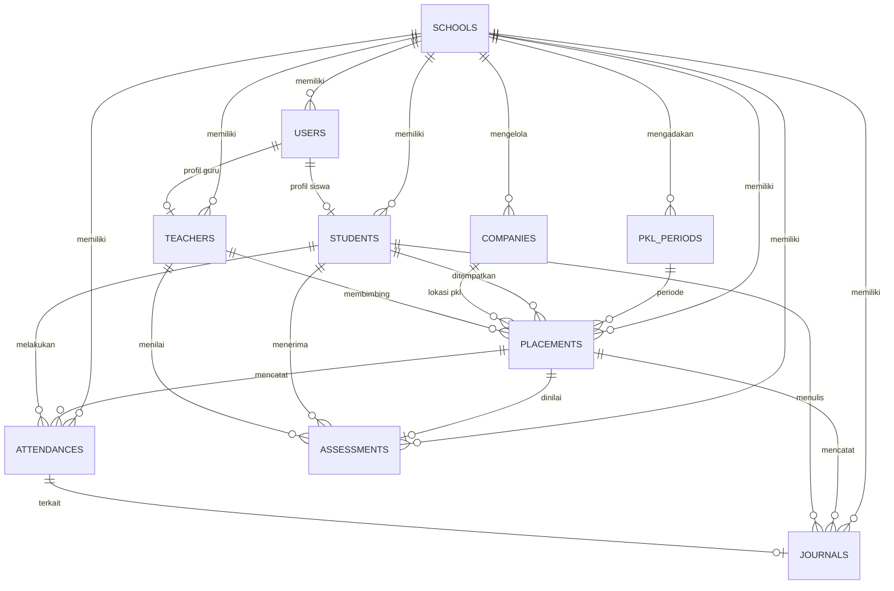

# Database Schema Specification - Jurnalin (PostgreSQL 16 + RLS)

Dokumen ini mendefinisikan struktur skema relasional PostgreSQL 16 untuk **Jurnalin** menggunakan model multi-tenant **Single Database, Shared Schema** dengan penegakan **Row-Level Security (RLS)** pada seluruh tabel tenant.

---

## 1. Entity Relationship Diagram (ERD)



---

## 2. Prinsip Desain Skema

1. **Primary Key UUID (`uuid`)**: Seluruh tabel menggunakan `UUID` (UUIDv7 dari trait Laravel `HasUuids` atau `gen_random_uuid()` di level SQL) untuk mencegah enumerasi ID antarsekolah melalui URL (`/students/1`, `/students/2`).
2. **Denormalisasi `school_id` untuk Kecepatan & Keamanan RLS**: Kolom `school_id UUID NOT NULL` sengaja ditempatkan langsung di `placements`, `attendances`, `journals`, dan `assessments` meskipun secara relasional bisa diturunkan dari `placements`. Tujuannya agar policy RLS cukup memeriksa `school_id = current_setting(...)::uuid` secara langsung tanpa `JOIN` tambahan.
3. **Kesiapan Ekspansi V2 pada Tabel `companies`**: Pada MVP, `companies` memiliki `school_id` (daftar hotel dikelola terpisah oleh setiap sekolah). Kolom opsional `npwp` dan `google_place_id` disiapkan agar jika di V2 dilakukan penggabungan (*deduplication*) hotel lintas sekolah, pencocokan entitas hotel dapat dilakukan tanpa merusak relasi `placements`.
4. **Tipe Waktu & Geografis**: Semua timestamp memakai `timestamptz` (UTC di database, dikonversi sesuai zona waktu sekolah WIB/WITA/WIT saat ditampilkan). Koordinat memakai `numeric(10,7)` dengan presisi ~1.1 cm.

---

## 3. Spesifikasi Detail 10 Tabel Inti

### 3.1 `schools` (Tabel Tenant)
| Kolom | Tipe Data | Constraint | Keterangan |
|---|---|---|---|
| `id` | `uuid` | `PK, NOT NULL` | ID unik sekolah |
| `npsn` | `char(8)` | `UNIQUE, NOT NULL` | Nomor Pokok Sekolah Nasional (8 digit) |
| `name` | `text` | `NOT NULL` | Nama resmi SMK |
| `address` | `text` | `NOT NULL` | Alamat lengkap sekolah |
| `city` | `text` | `NOT NULL` | Kabupaten/Kota |
| `province` | `text` | `NOT NULL` | Provinsi |
| `timezone` | `varchar(32)` | `NOT NULL, DEFAULT 'Asia/Jakarta'` | Zona waktu (`Asia/Jakarta`, `Asia/Makassar`, `Asia/Jayapura`) |
| `logo_path` | `text` | `NULL` | Jalur file logo di object storage |
| `letterhead_config` | `jsonb` | `NOT NULL, DEFAULT '{}'` | Konfigurasi kop surat PDF (nama dinas, nama & NIP kepsek, telp/email kop) |
| `default_geofence_radius_m` | `integer` | `NOT NULL, DEFAULT 200` | Radius absensi bawaan dalam meter |
| `late_tolerance_minutes` | `integer` | `NOT NULL, DEFAULT 15` | Batas keterlambatan sebelum ditandai `late` |
| `require_attendance_photo` | `boolean` | `NOT NULL, DEFAULT true` | Wajib selfie saat absen |
| `require_industry_form_photo` | `boolean` | `NOT NULL, DEFAULT true` | Wajib unggah foto form nilai kertas hotel saat finalisasi |
| `subscription_tier` | `varchar(32)` | `NOT NULL, DEFAULT 'free_pilot'` | `free_pilot`, `per_student`, `enterprise` |
| `max_students_quota` | `integer` | `NOT NULL, DEFAULT 35` | Kuota siswa aktif sesuai paket |
| `status` | `varchar(32)` | `NOT NULL, DEFAULT 'pending_verification'` | `pending_verification`, `active`, `suspended` |
| `verified_at` | `timestamptz` | `NULL` | Waktu verifikasi NPSN oleh Super Admin |
| `created_at` / `updated_at` | `timestamptz` | `NOT NULL` | Audit timestamp |

### 3.2 `users`
| Kolom | Tipe Data | Constraint | Keterangan |
|---|---|---|---|
| `id` | `uuid` | `PK, NOT NULL` | ID akun |
| `school_id` | `uuid` | `FK -> schools.id, NULL` | Wajib terisi kecuali untuk `super_admin` |
| `name` | `text` | `NOT NULL` | Nama lengkap pengguna |
| `email` | `text` | `UNIQUE, NOT NULL` | Email login |
| `phone` | `varchar(24)` | `NULL` | Nomor WhatsApp aktif (format `628...`) |
| `password` | `text` | `NOT NULL` | Bcrypt/Argon2id hash |
| `role` | `varchar(32)` | `NOT NULL` | `super_admin`, `school_admin`, `teacher`, `student` |
| `is_active` | `boolean` | `NOT NULL, DEFAULT true` | Status aktif akun |
| `must_change_password` | `boolean` | `NOT NULL, DEFAULT false` | Paksa ganti password setelah impor Excel |
| `last_login_at` | `timestamptz` | `NULL` | Login terakhir |
| `remember_token` | `varchar(100)` | `NULL` | Session token Laravel |
| `created_at` / `updated_at` | `timestamptz` | `NOT NULL` | Audit timestamp |

### 3.3 `teachers`
| Kolom | Tipe Data | Constraint | Keterangan |
|---|---|---|---|
| `id` | `uuid` | `PK, NOT NULL` | ID guru pembimbing |
| `school_id` | `uuid` | `FK -> schools.id, NOT NULL` | Tenant sekolah |
| `user_id` | `uuid` | `UNIQUE FK -> users.id, NOT NULL` | Akun login guru |
| `nip_nik` | `varchar(32)` | `NULL` | NIP atau NIK guru |
| `specialization` | `text` | `NULL` | Jurusan/keahlian (contoh: Perhotelan, Tata Boga) |
| `max_mentees` | `integer` | `NOT NULL, DEFAULT 20` | Batas ideal jumlah siswa bimbingan |
| `created_at` / `updated_at` | `timestamptz` | `NOT NULL` | Audit timestamp |

### 3.4 `students`
| Kolom | Tipe Data | Constraint | Keterangan |
|---|---|---|---|
| `id` | `uuid` | `PK, NOT NULL` | ID siswa |
| `school_id` | `uuid` | `FK -> schools.id, NOT NULL` | Tenant sekolah |
| `user_id` | `uuid` | `UNIQUE FK -> users.id, NOT NULL` | Akun login siswa |
| `nisn` | `varchar(16)` | `NOT NULL` | Nomor Induk Siswa Nasional (unik per sekolah) |
| `nis` | `varchar(24)` | `NULL` | Nomor Induk Siswa internal sekolah |
| `class_name` | `varchar(64)` | `NOT NULL` | Kelas (contoh: `XII Perhotelan 1`) |
| `major` | `varchar(100)` | `NOT NULL` | Konsentrasi keahlian |
| `gender` | `char(1)` | `NULL` | `L` atau `P` |
| `parent_phone` | `varchar(24)` | `NULL` | Nomor WA orang tua/wali |
| `created_at` / `updated_at` | `timestamptz` | `NOT NULL` | Audit timestamp |

Constraint unik: `UNIQUE (school_id, nisn)`.

### 3.5 `companies` (Tempat PKL / DUDI Milik Sekolah)
| Kolom | Tipe Data | Constraint | Keterangan |
|---|---|---|---|
| `id` | `uuid` | `PK, NOT NULL` | ID tempat PKL |
| `school_id` | `uuid` | `FK -> schools.id, NOT NULL` | Tenant sekolah pemilik data |
| `name` | `text` | `NOT NULL` | Nama hotel/restoran/perusahaan |
| `industry_type` | `varchar(64)` | `NOT NULL` | Kategori (contoh: `Hotel Bintang 4`, `Resort`, `Restoran`) |
| `address` | `text` | `NOT NULL` | Alamat fisik lokasi kerja |
| `city` | `text` | `NOT NULL` | Kota |
| `contact_person_name` | `text` | `NULL` | Nama HRD / Training Manager |
| `contact_person_phone` | `varchar(24)` | `NULL` | Nomor telepon/WA HRD |
| `latitude` | `numeric(10,7)` | `NOT NULL` | Titik lintang pusat lokasi |
| `longitude` | `numeric(10,7)` | `NOT NULL` | Titik bujur pusat lokasi |
| `geofence_radius_m` | `integer` | `NULL` | Override radius khusus tempat ini (jika null pakai default sekolah) |
| `npwp` | `varchar(32)` | `NULL` | Opsional, disiapkan untuk deduplikasi V2 |
| `google_place_id` | `text` | `NULL` | Opsional, disiapkan untuk deduplikasi V2 |
| `is_active` | `boolean` | `NOT NULL, DEFAULT true` | Status aktif mitra |
| `created_at` / `updated_at` | `timestamptz` | `NOT NULL` | Audit timestamp |

### 3.6 `pkl_periods`
| Kolom | Tipe Data | Constraint | Keterangan |
|---|---|---|---|
| `id` | `uuid` | `PK, NOT NULL` | ID periode |
| `school_id` | `uuid` | `FK -> schools.id, NOT NULL` | Tenant sekolah |
| `name` | `text` | `NOT NULL` | Nama periode (contoh: `PKL Gelombang 1 TA 2026/2027`) |
| `academic_year` | `varchar(16)` | `NOT NULL` | Contoh: `2026/2027` |
| `start_date` | `date` | `NOT NULL` | Tanggal mulai efektif PKL |
| `end_date` | `date` | `NOT NULL` | Tanggal berakhir PKL |
| `min_required_days` | `integer` | `NOT NULL, DEFAULT 120` | Target minimal hari kehadiran (6 bulan) |
| `assessment_template` | `jsonb` | `NOT NULL` | Definisi aspek, bobot, dan skala predikat |
| `is_active` | `boolean` | `NOT NULL, DEFAULT true` | Menandai periode yang sedang berjalan |
| `created_at` / `updated_at` | `timestamptz` | `NOT NULL` | Audit timestamp |

### 3.7 `placements`
| Kolom | Tipe Data | Constraint | Keterangan |
|---|---|---|---|
| `id` | `uuid` | `PK, NOT NULL` | ID penempatan siswa |
| `school_id` | `uuid` | `FK -> schools.id, NOT NULL` | Tenant sekolah |
| `pkl_period_id` | `uuid` | `FK -> pkl_periods.id, NOT NULL` | Periode PKL |
| `student_id` | `uuid` | `FK -> students.id, NOT NULL` | Siswa PKL |
| `company_id` | `uuid` | `FK -> companies.id, NOT NULL` | Hotel/Tempat PKL |
| `teacher_id` | `uuid` | `FK -> teachers.id, NOT NULL` | Guru pembimbing penanggung jawab |
| `department_divisi` | `varchar(100)` | `NULL` | Divisi kerja (contoh: `Front Office`, `Housekeeping`) |
| `industry_mentor_name` | `text` | `NULL` | Nama supervisor hotel (teks biasa di MVP) |
| `industry_mentor_phone` | `varchar(24)` | `NULL` | No WA supervisor hotel (teks biasa, siap untuk V2) |
| `work_start_time` | `time` | `NOT NULL, DEFAULT '08:00:00'` | Jam masuk shift acuan |
| `work_end_time` | `time` | `NOT NULL, DEFAULT '16:00:00'` | Jam pulang shift acuan |
| `status` | `varchar(32)` | `NOT NULL, DEFAULT 'active'` | `scheduled`, `active`, `completed`, `cancelled` |
| `created_at` / `updated_at` | `timestamptz` | `NOT NULL` | Audit timestamp |

Constraint unik parsial: 1 siswa hanya boleh memiliki 1 penempatan berstatus `active` per periode (`UNIQUE (school_id, pkl_period_id, student_id) WHERE status = 'active'`).

### 3.8 `attendances`
| Kolom | Tipe Data | Constraint | Keterangan |
|---|---|---|---|
| `id` | `uuid` | `PK, NOT NULL` | ID catatan kehadiran |
| `school_id` | `uuid` | `FK -> schools.id, NOT NULL` | Tenant sekolah |
| `placement_id` | `uuid` | `FK -> placements.id, NOT NULL` | Penempatan aktif |
| `student_id` | `uuid` | `FK -> students.id, NOT NULL` | Siswa bersangkutan |
| `attendance_date` | `date` | `NOT NULL` | Tanggal kalender absensi |
| `status` | `varchar(32)` | `NOT NULL` | `present`, `late`, `sick`, `permission`, `absent` |
| `check_in_at` | `timestamptz` | `NULL` | Waktu check-in |
| `check_in_lat` | `numeric(10,7)` | `NULL` | Latitude saat check-in |
| `check_in_lng` | `numeric(10,7)` | `NULL` | Longitude saat check-in |
| `check_in_distance_m` | `integer` | `NULL` | Jarak terhitung server dalam meter |
| `check_in_gps_accuracy_m` | `integer` | `NULL` | Akurasi GPS perangkat dalam meter |
| `check_in_photo_path` | `text` | `NULL` | Jalur foto selfie/bukti izin di S3/R2 |
| `is_within_radius` | `boolean` | `NOT NULL, DEFAULT true` | Hasil validasi radius oleh server |
| `check_out_at` | `timestamptz` | `NULL` | Waktu pulang |
| `check_out_lat` | `numeric(10,7)` | `NULL` | Latitude saat check-out |
| `check_out_lng` | `numeric(10,7)` | `NULL` | Longitude saat check-out |
| `check_out_distance_m` | `integer` | `NULL` | Jarak check-out dalam meter |
| `check_out_photo_path` | `text` | `NULL` | Foto saat check-out (opsional) |
| `exception_reason` | `text` | `NULL` | Alasan jika di luar radius (tugas luar) atau sakit/izin |
| `approved_by_teacher_id` | `uuid` | `FK -> teachers.id, NULL` | Guru yang menyetujui pengecualian/izin |
| `created_at` / `updated_at` | `timestamptz` | `NOT NULL` | Audit timestamp |

Constraint unik: `UNIQUE (school_id, placement_id, attendance_date)`.

### 3.9 `journals`
| Kolom | Tipe Data | Constraint | Keterangan |
|---|---|---|---|
| `id` | `uuid` | `PK, NOT NULL` | ID jurnal kegiatan |
| `school_id` | `uuid` | `FK -> schools.id, NOT NULL` | Tenant sekolah |
| `placement_id` | `uuid` | `FK -> placements.id, NOT NULL` | Penempatan |
| `student_id` | `uuid` | `FK -> students.id, NOT NULL` | Penulis jurnal |
| `attendance_id` | `uuid` | `FK -> attendances.id, NULL` | Tautan absensi di hari yang sama |
| `journal_date` | `date` | `NOT NULL` | Tanggal kegiatan |
| `work_unit` | `varchar(100)` | `NOT NULL` | Unit kerja/bagian (misal: `Pastry Kitchen`, `Room Division`) |
| `activity_title` | `varchar(200)` | `NOT NULL` | Ringkasan judul pekerjaan |
| `activity_description` | `text` | `NOT NULL` | Uraian detail prosedur yang dilakukan |
| `tools_materials` | `text` | `NULL` | Alat, perlengkapan, atau sistem yang dipakai |
| `learning_outcome` | `text` | `NULL` | Kompetensi yang dipelajari / kendala yang diselesaikan |
| `photo_path` | `text` | `NULL` | Foto dokumentasi pekerjaan |
| `duration_minutes` | `integer` | `NOT NULL, DEFAULT 480` | Durasi kerja dalam menit |
| `status` | `varchar(32)` | `NOT NULL, DEFAULT 'submitted'` | `draft`, `submitted`, `revision_needed`, `approved` |
| `teacher_feedback` | `text` | `NULL` | Catatan guru saat meminta revisi atau memberi apresiasi |
| `validated_by_teacher_id` | `uuid` | `FK -> teachers.id, NULL` | Guru validator |
| `validated_at` | `timestamptz` | `NULL` | Waktu validasi |
| `created_at` / `updated_at` | `timestamptz` | `NOT NULL` | Audit timestamp |

### 3.10 `assessments`
| Kolom | Tipe Data | Constraint | Keterangan |
|---|---|---|---|
| `id` | `uuid` | `PK, NOT NULL` | ID penilaian akhir |
| `school_id` | `uuid` | `FK -> schools.id, NOT NULL` | Tenant sekolah |
| `placement_id` | `uuid` | `UNIQUE FK -> placements.id, NOT NULL` | 1 penilaian final per penempatan |
| `student_id` | `uuid` | `FK -> students.id, NOT NULL` | Siswa yang dinilai |
| `teacher_id` | `uuid` | `FK -> teachers.id, NOT NULL` | Guru yang menginput & memfinalisasi |
| `school_scores` | `jsonb` | `NOT NULL` | Rincian nilai pembimbing sekolah sesuai rubrik |
| `industry_scores` | `jsonb` | `NOT NULL` | Rincian nilai dari hotel (disalin guru dari form kertas) |
| `industry_form_photo_path` | `text` | `NULL` | Foto bukti lembar penilaian asli yang ditandatangani pihak hotel |
| `attendance_score` | `numeric(5,2)` | `NOT NULL` | Nilai komponen kehadiran (dihitung sistem 0.00-100.00) |
| `final_score` | `numeric(5,2)` | `NOT NULL` | Nilai akhir tertimbang |
| `predicate` | `varchar(32)` | `NOT NULL` | `Amat Baik`, `Baik`, `Cukup`, `Kurang` |
| `teacher_notes` | `text` | `NULL` | Catatan evaluasi guru pembimbing |
| `industry_notes` | `text` | `NULL` | Catatan/komentar dari lembar penilaian hotel |
| `certificate_number` | `varchar(100)` | `NULL` | Nomor surat keterangan / sertifikat sekolah |
| `finalized_at` | `timestamptz` | `NULL` | Terisi saat nilai dikunci dan siap dicetak PDF |
| `created_at` / `updated_at` | `timestamptz` | `NOT NULL` | Audit timestamp |

Constraint unik: `UNIQUE (school_id, placement_id)`.

---

## 4. Contoh Payload `JSONB` Penilaian

### `assessments.industry_scores` & `assessments.school_scores`
```json
// assessments.industry_scores (disalin guru dari lembar kertas hotel)
{
  "scores": {
    "soft_skills": 90,
    "hard_skills": 88,
    "initiative": 85
  },
  "weighted_average": 88.35,
  "signed_by_name": "Budi Santoso (HR Manager)",
  "signed_date": "2026-11-10"
}

// assessments.school_scores
{
  "scores": {
    "journal_quality": 92,
    "report_presentation": 88
  },
  "weighted_average": 90.00
}
```

---

## 5. Skrip PostgreSQL 16 DDL, Indexes & Row-Level Security (RLS)

Skrip SQL di bawah ini menjadi acuan migrasi database untuk menjamin integritas relasi, performa query dashboard guru, serta isolasi multi-tenant yang dipaksakan oleh PostgreSQL:

```sql
-- Ekstensi UUID
CREATE EXTENSION IF NOT EXISTS pgcrypto;

-- Fungsi helper pembaca variabel sesi transaksi lokal secara aman
CREATE OR REPLACE FUNCTION app_current_school_id() RETURNS uuid AS $$
  SELECT NULLIF(current_setting('app.current_school_id', true), '')::uuid;
$$ LANGUAGE sql STABLE;

CREATE OR REPLACE FUNCTION app_is_super_admin() RETURNS boolean AS $$
  SELECT COALESCE(current_setting('app.is_super_admin', true), 'false') = 'true';
$$ LANGUAGE sql STABLE;

-- 1. SCHOOLS
CREATE TABLE schools (
    id uuid PRIMARY KEY DEFAULT gen_random_uuid(),
    npsn char(8) NOT NULL UNIQUE,
    name text NOT NULL,
    address text NOT NULL,
    city text NOT NULL,
    province text NOT NULL,
    timezone varchar(32) NOT NULL DEFAULT 'Asia/Jakarta',
    logo_path text,
    letterhead_config jsonb NOT NULL DEFAULT '{}'::jsonb,
    default_geofence_radius_m integer NOT NULL DEFAULT 200,
    late_tolerance_minutes integer NOT NULL DEFAULT 15,
    require_attendance_photo boolean NOT NULL DEFAULT true,
    require_industry_form_photo boolean NOT NULL DEFAULT true,
    subscription_tier varchar(32) NOT NULL DEFAULT 'free_pilot',
    max_students_quota integer NOT NULL DEFAULT 35,
    status varchar(32) NOT NULL DEFAULT 'pending_verification',
    verified_at timestamptz,
    created_at timestamptz NOT NULL DEFAULT now(),
    updated_at timestamptz NOT NULL DEFAULT now()
);

-- 2. USERS (school_id NULL hanya untuk super_admin)
CREATE TABLE users (
    id uuid PRIMARY KEY DEFAULT gen_random_uuid(),
    school_id uuid REFERENCES schools(id) ON DELETE CASCADE,
    name text NOT NULL,
    email text NOT NULL UNIQUE,
    phone varchar(24),
    password text NOT NULL,
    role varchar(32) NOT NULL CHECK (role IN ('super_admin', 'school_admin', 'teacher', 'student')),
    is_active boolean NOT NULL DEFAULT true,
    must_change_password boolean NOT NULL DEFAULT false,
    last_login_at timestamptz,
    remember_token varchar(100),
    created_at timestamptz NOT NULL DEFAULT now(),
    updated_at timestamptz NOT NULL DEFAULT now(),
    CONSTRAINT users_tenant_check CHECK (
        (role = 'super_admin' AND school_id IS NULL) OR
        (role <> 'super_admin' AND school_id IS NOT NULL)
    )
);

-- 3. TEACHERS
CREATE TABLE teachers (
    id uuid PRIMARY KEY DEFAULT gen_random_uuid(),
    school_id uuid NOT NULL REFERENCES schools(id) ON DELETE CASCADE,
    user_id uuid NOT NULL UNIQUE REFERENCES users(id) ON DELETE CASCADE,
    nip_nik varchar(32),
    specialization text,
    max_mentees integer NOT NULL DEFAULT 20,
    created_at timestamptz NOT NULL DEFAULT now(),
    updated_at timestamptz NOT NULL DEFAULT now()
);

-- 4. STUDENTS
CREATE TABLE students (
    id uuid PRIMARY KEY DEFAULT gen_random_uuid(),
    school_id uuid NOT NULL REFERENCES schools(id) ON DELETE CASCADE,
    user_id uuid NOT NULL UNIQUE REFERENCES users(id) ON DELETE CASCADE,
    nisn varchar(16) NOT NULL,
    nis varchar(24),
    class_name varchar(64) NOT NULL,
    major varchar(100) NOT NULL,
    gender char(1) CHECK (gender IN ('L', 'P')),
    parent_phone varchar(24),
    created_at timestamptz NOT NULL DEFAULT now(),
    updated_at timestamptz NOT NULL DEFAULT now(),
    UNIQUE (school_id, nisn)
);

-- 5. COMPANIES (Tempat PKL / DUDI milik sekolah di MVP)
CREATE TABLE companies (
    id uuid PRIMARY KEY DEFAULT gen_random_uuid(),
    school_id uuid NOT NULL REFERENCES schools(id) ON DELETE CASCADE,
    name text NOT NULL,
    industry_type varchar(64) NOT NULL,
    address text NOT NULL,
    city text NOT NULL,
    contact_person_name text,
    contact_person_phone varchar(24),
    latitude numeric(10,7) NOT NULL,
    longitude numeric(10,7) NOT NULL,
    geofence_radius_m integer,
    npwp varchar(32),
    google_place_id text,
    is_active boolean NOT NULL DEFAULT true,
    created_at timestamptz NOT NULL DEFAULT now(),
    updated_at timestamptz NOT NULL DEFAULT now()
);

-- 6. PKL_PERIODS
CREATE TABLE pkl_periods (
    id uuid PRIMARY KEY DEFAULT gen_random_uuid(),
    school_id uuid NOT NULL REFERENCES schools(id) ON DELETE CASCADE,
    name text NOT NULL,
    academic_year varchar(16) NOT NULL,
    start_date date NOT NULL,
    end_date date NOT NULL,
    min_required_days integer NOT NULL DEFAULT 120,
    assessment_template jsonb NOT NULL,
    is_active boolean NOT NULL DEFAULT true,
    created_at timestamptz NOT NULL DEFAULT now(),
    updated_at timestamptz NOT NULL DEFAULT now()
);

-- 7. PLACEMENTS
CREATE TABLE placements (
    id uuid PRIMARY KEY DEFAULT gen_random_uuid(),
    school_id uuid NOT NULL REFERENCES schools(id) ON DELETE CASCADE,
    pkl_period_id uuid NOT NULL REFERENCES pkl_periods(id) ON DELETE CASCADE,
    student_id uuid NOT NULL REFERENCES students(id) ON DELETE CASCADE,
    company_id uuid NOT NULL REFERENCES companies(id) ON DELETE RESTRICT,
    teacher_id uuid NOT NULL REFERENCES teachers(id) ON DELETE RESTRICT,
    department_divisi varchar(100),
    industry_mentor_name text,
    industry_mentor_phone varchar(24),
    work_start_time time NOT NULL DEFAULT '08:00:00',
    work_end_time time NOT NULL DEFAULT '16:00:00',
    status varchar(32) NOT NULL DEFAULT 'active' CHECK (status IN ('scheduled', 'active', 'completed', 'cancelled')),
    created_at timestamptz NOT NULL DEFAULT now(),
    updated_at timestamptz NOT NULL DEFAULT now()
);

CREATE UNIQUE INDEX idx_placements_one_active_per_period
    ON placements (school_id, pkl_period_id, student_id)
    WHERE status = 'active';

-- 8. ATTENDANCES
CREATE TABLE attendances (
    id uuid PRIMARY KEY DEFAULT gen_random_uuid(),
    school_id uuid NOT NULL REFERENCES schools(id) ON DELETE CASCADE,
    placement_id uuid NOT NULL REFERENCES placements(id) ON DELETE CASCADE,
    student_id uuid NOT NULL REFERENCES students(id) ON DELETE CASCADE,
    attendance_date date NOT NULL,
    status varchar(32) NOT NULL CHECK (status IN ('present', 'late', 'sick', 'permission', 'absent')),
    check_in_at timestamptz,
    check_in_lat numeric(10,7),
    check_in_lng numeric(10,7),
    check_in_distance_m integer,
    check_in_gps_accuracy_m integer,
    check_in_photo_path text,
    is_within_radius boolean NOT NULL DEFAULT true,
    check_out_at timestamptz,
    check_out_lat numeric(10,7),
    check_out_lng numeric(10,7),
    check_out_distance_m integer,
    check_out_photo_path text,
    exception_reason text,
    approved_by_teacher_id uuid REFERENCES teachers(id) ON DELETE SET NULL,
    created_at timestamptz NOT NULL DEFAULT now(),
    updated_at timestamptz NOT NULL DEFAULT now(),
    UNIQUE (school_id, placement_id, attendance_date)
);

-- 9. JOURNALS
CREATE TABLE journals (
    id uuid PRIMARY KEY DEFAULT gen_random_uuid(),
    school_id uuid NOT NULL REFERENCES schools(id) ON DELETE CASCADE,
    placement_id uuid NOT NULL REFERENCES placements(id) ON DELETE CASCADE,
    student_id uuid NOT NULL REFERENCES students(id) ON DELETE CASCADE,
    attendance_id uuid REFERENCES attendances(id) ON DELETE SET NULL,
    journal_date date NOT NULL,
    work_unit varchar(100) NOT NULL,
    activity_title varchar(200) NOT NULL,
    activity_description text NOT NULL,
    tools_materials text,
    learning_outcome text,
    photo_path text,
    duration_minutes integer NOT NULL DEFAULT 480,
    status varchar(32) NOT NULL DEFAULT 'submitted' CHECK (status IN ('draft', 'submitted', 'revision_needed', 'approved')),
    teacher_feedback text,
    validated_by_teacher_id uuid REFERENCES teachers(id) ON DELETE SET NULL,
    validated_at timestamptz,
    created_at timestamptz NOT NULL DEFAULT now(),
    updated_at timestamptz NOT NULL DEFAULT now()
);

-- 10. ASSESSMENTS
CREATE TABLE assessments (
    id uuid PRIMARY KEY DEFAULT gen_random_uuid(),
    school_id uuid NOT NULL REFERENCES schools(id) ON DELETE CASCADE,
    placement_id uuid NOT NULL REFERENCES placements(id) ON DELETE CASCADE,
    student_id uuid NOT NULL REFERENCES students(id) ON DELETE CASCADE,
    teacher_id uuid NOT NULL REFERENCES teachers(id) ON DELETE RESTRICT,
    school_scores jsonb NOT NULL,
    industry_scores jsonb NOT NULL,
    industry_form_photo_path text,
    attendance_score numeric(5,2) NOT NULL DEFAULT 0,
    final_score numeric(5,2) NOT NULL DEFAULT 0,
    predicate varchar(32) NOT NULL,
    teacher_notes text,
    industry_notes text,
    certificate_number varchar(100),
    finalized_at timestamptz,
    created_at timestamptz NOT NULL DEFAULT now(),
    updated_at timestamptz NOT NULL DEFAULT now(),
    UNIQUE (school_id, placement_id)
);

-- COMPOSITE INDEXES UNTUK QUERY OPERASIONAL HARIAN
CREATE INDEX idx_teachers_school_id ON teachers (school_id);
CREATE INDEX idx_students_school_class ON students (school_id, class_name);
CREATE INDEX idx_companies_school_active ON companies (school_id, is_active);
CREATE INDEX idx_periods_school_active ON pkl_periods (school_id, is_active);
CREATE INDEX idx_placements_teacher_status ON placements (school_id, teacher_id, status);
CREATE INDEX idx_attendances_school_date ON attendances (school_id, attendance_date, placement_id);
CREATE INDEX idx_journals_validation_queue ON journals (school_id, status, journal_date);
CREATE INDEX idx_journals_placement_date ON journals (school_id, placement_id, journal_date);
CREATE INDEX idx_assessments_school_student ON assessments (school_id, student_id);

-- PENEGAKAN ROW-LEVEL SECURITY (RLS)
-- Catatan: Tabel users menggunakan policy khusus agar proses login tetap bisa mencari email saat app.auth_lookup_email disetel,
-- sedangkan operasi tenant lain tetap terkunci ke app_current_school_id().

ALTER TABLE users ENABLE ROW LEVEL SECURITY;
ALTER TABLE users FORCE ROW LEVEL SECURITY;
CREATE POLICY users_tenant_or_auth_policy ON users
    USING (
        app_is_super_admin()
        OR school_id = app_current_school_id()
        OR email = NULLIF(current_setting('app.auth_lookup_email', true), '')
    )
    WITH CHECK (
        app_is_super_admin()
        OR school_id = app_current_school_id()
    );

-- Policy seragam pada seluruh 8 tabel operasional milik sekolah
DO $$
DECLARE
    tbl text;
BEGIN
    FOREACH tbl IN ARRAY ARRAY[
        'teachers', 'students', 'companies', 'pkl_periods',
        'placements', 'attendances', 'journals', 'assessments'
    ]
    LOOP
        EXECUTE format('ALTER TABLE %I ENABLE ROW LEVEL SECURITY;', tbl);
        EXECUTE format('ALTER TABLE %I FORCE ROW LEVEL SECURITY;', tbl);
        EXECUTE format(
            'CREATE POLICY tenant_isolation_policy ON %I USING (app_is_super_admin() OR school_id = app_current_school_id()) WITH CHECK (app_is_super_admin() OR school_id = app_current_school_id());',
            tbl
        );
    END LOOP;
END $$;
```

**Catatan Keamanan Database User**:
Pastikan user koneksi PostgreSQL yang dipakai Laravel di `.env` (`DB_USERNAME=jurnalin_app`) **bukan** superuser PostgreSQL dan **tidak** memiliki atribut `BYPASSRLS`. Meskipun `FORCE ROW LEVEL SECURITY` sudah diaktifkan untuk pemilik tabel, peran non-superuser dengan hak standar `SELECT, INSERT, UPDATE, DELETE` wajib digunakan di produksi.

## Kelas dan Grup Penempatan per Periode

Migrasi `2026_11_18_000013_create_period_classes_and_placement_groups.php`. Ketiga tabel memakai `school_id` + RLS FORCE.

| Tabel | Kolom utama | Aturan |
|---|---|---|
| `period_classes` | `pkl_period_id`, `name`, `major` | Nama kelas unik per periode. Saat dibuat, siswa dengan `students.class_name` yang sama disalin sebagai anggota. |
| `period_class_members` | `period_class_id`, `pkl_period_id`, `student_id` | PK `(pkl_period_id, student_id)`: satu siswa satu kelas per periode. Tidak ikut berubah saat siswa naik kelas. |
| `placement_groups` | `pkl_period_id`, `name`, `company_id`, `teacher_id`, `department_divisi`, `work_start_time`, `work_end_time` | Satu tempat PKL + satu guru pembimbing. Nama unik per periode. |
| `placements.placement_group_id` | FK nullable, `nullOnDelete` | Menambah anggota grup membuat penempatan aktif (lewat `ActivatePlacementAction`). Mengubah guru/jam grup memperbarui semua penempatan anggota. Menghapus grup tidak mengakhiri penempatan. |

Logika ada di `App\Http\Controllers\Spec\PeriodRosterController`; tampilan di halaman periode (`/admin/periods/{id}?tab=kelas|grup|penempatan`). Grup penempatan berbeda dari `billing_groups` (tagihan langganan, menu Pembayaran).
