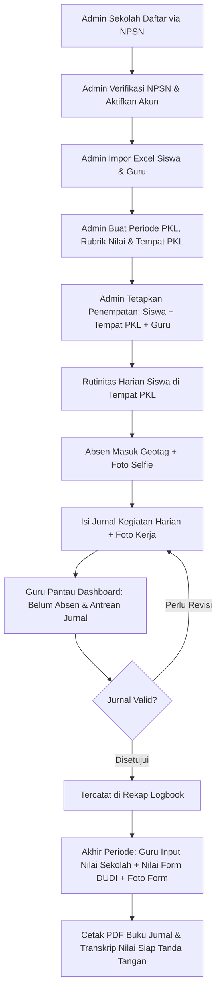

# Product Requirements Document (PRD) - Jurnalin

**Versi Dokumen**: 1.0 (MVP Sekolah-First Multi-Tenant)  
**Tanggal**: 16 November 2026  
**Target Pasar**: Seluruh SMK di Indonesia lintas program keahlian (Teknologi Informasi, Teknik Manufaktur, Otomotif, Bisnis & Manajemen, Pariwisata, Kesehatan, Agribisnis, Kemaritiman, Seni & Ekonomi Kreatif). Pilot awal dimulai dari SMK Perhotelan & Pariwisata.

---

## 1. Ringkasan Eksekutif & Konteks Masalah

### 1.1 Latar Belakang Kurikulum
Dalam implementasi Kurikulum Merdeka pada Sekolah Menengah Kejuruan (SMK), Praktik Kerja Lapangan (PKL) bukan lagi sekadar kegiatan tambahan, melainkan **mata pelajaran wajib** bagi seluruh siswa kelas XII (program 3 tahun) dengan durasi minimal **6 bulan (setara 792 jam pelajaran)**. Karena bersifat wajib dan berulang setiap tahun ajaran, setiap SMK di Indonesia harus mengelola ratusan hingga ribuan penempatan siswa di Dunia Usaha dan Dunia Industri (DUDI).

### 1.2 Masalah Lapangan yang Ditemui
1. **Sisi Siswa & Guru Pembimbing**:
   - Pengisian jurnal kegiatan masih menggunakan buku cetak fisik yang mudah basah, kotor, tertinggal di kos, atau hilang sebelum akhir masa PKL.
   - Guru pembimbing harus memantau kehadiran dan progres kegiatan secara manual lewat chat WhatsApp grup yang tidak terstruktur, atau datang langsung ke hotel hanya untuk memeriksa buku fisik.
   - Rekapitulasi nilai akhir dan kelengkapan kehadiran di akhir semester memakan waktu berhari-hari karena harus memindahkan tulisan tangan ke Excel.
2. **Sisi Dunia Usaha & Dunia Industri (DUDI: perusahaan IT, pabrik, bengkel, bank, hotel, rumah sakit, instansi)**:
   - Supervisor atau HRD hotel sangat sibuk dengan operasional shift harian dan enggan membuat akun baru atau menginstal aplikasi khusus dari puluhan sekolah yang berbeda.
   - Akibatnya, aplikasi PKL yang mewajibkan hotel login sering kali macet di lapangan karena pembimbing hotel tidak pernah membuka akunnya.

### 1.3 Solusi MVP (Fokus Sekolah dengan 4 Peran)
**Jurnalin** adalah platform SaaS manajemen PKL multi-tenant yang memungkinkan setiap SMK mengelola operasional PKL dari pendaftaran hingga rapor nilai siap cetak dalam satu sistem terisolasi.

Pada versi MVP, **pihak DUDI / tempat PKL dikelola sebagai data milik sekolah tanpa akun login**. Penilaian dari pembimbing industri di hotel tetap diakomodasi sesuai standar Kurikulum Merdeka melalui skema input oleh guru pembimbing (menyalin nilai dari form kertas hotel disertai unggahan foto form asli yang sudah ditandatangani sebagai bukti audit). Keputusan ini menghilangkan hambatan adopsi di sisi hotel sambil tetap menjaga seluruh catatan nilai terdigitalisasi. Fondasi data tetap disiapkan agar di Fase V2 fitur link penilaian WhatsApp tanpa login dapat diaktifkan tanpa membongkar arsitektur.

---

## 2. Profil Pengguna & Cakupan Akses (4 Peran)

| Peran | Aktor di Sekolah | Cakupan Data | Pekerjaan Utama (*Jobs-to-be-Done*) |
|---|---|---|---|
| **Admin** (kode `super_admin`) | Pemilik Platform | Lintas semua sekolah | Memverifikasi pendaftaran sekolah baru melalui NPSN Kemendikdasmen, mengaktifkan paket langganan & kuota siswa, serta memberikan dukungan teknis |
| **Admin Sekolah** | Wakil Kepala Sekolah Hubin / Ketua BKK / Tata Usaha | 1 sekolah (`school_id`) | Mengimpor data siswa & guru dari Excel, mengatur periode PKL, menyusun rubrik penilaian sekolah, mengelola daftar tempat PKL & koordinatnya, memetakan penempatan siswa, serta mencetak rekap resmi |
| **Guru Pembimbing** | Guru produktif / pembimbing lapangan | Hanya siswa bimbingannya di 1 sekolah | Memantau siswa yang belum absen hari ini, memvalidasi jurnal harian (setujui atau minta revisi), menginput nilai pembimbing sekolah dan nilai dari form hotel beserta foto buktinya, serta mengunduh laporan siswa |
| **Siswa PKL** | Siswa kelas XII SMK | Hanya data dirinya sendiri | Melakukan absen masuk & pulang harian dari HP dengan verifikasi GPS dan foto selfie, menulis jurnal aktivitas kerja harian, memantau catatan revisi guru, dan melihat rekap nilai |

---

## 3. Alur Kerja Inti End-to-End

### Rincian Skenario Utama

1. **Pendaftaran & Verifikasi Sekolah**:
   - Koordinator Hubin mengisi form pendaftaran: NPSN (8 digit), nama sekolah, kota/provinsi, nama admin, email, dan nomor WhatsApp aktif.
   - Status sekolah menjadi `pending_verification`. Admin mencocokkan NPSN pada data referensi Kemendikdasmen secara manual pada tahap awal untuk mencegah tenant palsu, lalu mengubah status menjadi `active`.
2. **Onboarding Data Sekolah (Target < 15 Menit)**:
   - Admin mengunduh template Excel (`.xlsx`), mengisi daftar siswa (NISN, NIS, Nama, Kelas, Jurusan, No WA, No WA Orang Tua) dan daftar guru (NIP/NIK, Nama, Spesialisasi, No WA), lalu mengunggah untuk impor massal. Sistem otomatis membuat akun login awal dengan password bawaan yang wajib diganti saat login pertama (atau dikirim melalui daftar kredensial cetak/WA).
   - Admin membuat Periode PKL (tanggal mulai, tanggal selesai, minimal hari efektif, serta konfigurasi bobot rubrik penilaian).
   - Admin menambahkan Tempat PKL (nama perusahaan/instansi, kategori DUDI, alamat, kontak HRD/supervisor, serta titik pin koordinat peta dan radius toleransi).
   - Admin memetakan Penempatan (`placements`): memilih siswa, hotel tujuan, divisi (misal: *IT Support*, *Service Advisor*, *Front Office*, *Gudang*), jam shift, serta guru pembimbingnya.
3. **Rutinitas Harian Siswa (Mobile PWA)**:
   - Pagi hari saat tiba di hotel, siswa membuka Jurnalin dari browser HP. Sistem membaca koordinat GPS perangkat dan membandingkannya dengan titik koordinat hotel.
   - Jika berada dalam radius (default 200 meter), siswa mengambil foto selfie langsung dari kamera HP (tanpa memilih dari galeri jika mode ketat aktif) dan menekan tombol `Absen Masuk`.
   - Jika sedang ditugaskan hotel di luar area (misalnya *outside catering* atau *banquet event*), siswa dapat memilih opsi `Tugas Luar Area` dengan alasan wajib yang masuk ke daftar persetujuan guru.
   - Sebelum atau sesudah pulang kerja, siswa mengisi jurnal kegiatan: divisi/unit kerja, judul aktivitas, uraian langkah kerja, alat/bahan yang dipakai, capaian pembelajaran, durasi menit, dan 1 foto pendukung.
4. **Monitoring Harian & Validasi Guru**:
   - Guru membuka panel dan langsung melihat siswa yang belum absen melewati jam masuk (dengan tombol klik untuk mengirim pesan pengingat ke WhatsApp siswa).
   - Guru memeriksa antrean jurnal baru: guru dapat menyetujui beberapa jurnal sekaligus (*bulk approve*) atau mengembalikan jurnal dengan status `revision_needed` beserta catatan perbaikan.
5. **Penilaian Akhir & Cetak Laporan**:
   - Di akhir masa PKL, guru menerima lembar penilaian kertas yang sudah diisi dan ditandatangani oleh supervisor hotel.
   - Guru membuka halaman Penilaian Siswa, mengisi skor aspek sekolah, menyalin skor aspek industri dari kertas tersebut, dan **mengunggah foto lembar penilaian hotel** sebagai arsip bukti.
   - Sistem menghitung nilai akhir otomatis sesuai bobot rubrik sekolah, menentukan predikat, dan menghasilkan 2 dokumen PDF ber-kop sekolah: **Buku Jurnal Kegiatan PKL** dan **Rekap Nilai Akhir PKL**.

---

## 4. Spesifikasi Kebutuhan Fungsional (MVP)

| ID | Fitur | Prioritas | Kriteria Penerimaan (*Acceptance Criteria*) |
|---|---|---|---|
| **FR-01** | Registrasi Sekolah & Verifikasi NPSN | Must Have | Validasi format NPSN tepat 8 digit unik. Tenant baru tidak dapat login ke panel sekolah sebelum status berubah menjadi `active` oleh Admin. |
| **FR-02** | Isolasi Multi-Tenant (RLS) | Must Have | Semua query lintas tabel terikat `school_id` di level Eloquent dan PostgreSQL RLS. Pengujian lintas tenant wajib mengembalikan 0 data milik sekolah lain. |
| **FR-03** | Impor Massal Excel Siswa & Guru | Must Have | Mendukung berkas `.xlsx` hingga 1.000 baris per unggahan. Baris dengan NISN/email duplikat ditolak secara selektif dengan laporan baris error yang bisa diunduh. |
| **FR-04** | Manajemen Tempat PKL & Pin Peta | Must Have | Admin dapat mencari alamat atau menggeser pin di peta OpenStreetMap/Leaflet untuk menyimpan `latitude`, `longitude`, dan radius geofence khusus per lokasi. |
| **FR-05** | Manajemen Periode PKL & Rubrik JSON | Must Have | Admin dapat mendefinisikan aspek penilaian (aspek industri vs aspek sekolah) dengan total bobot wajib tepat `100%`. |
| **FR-06** | Penempatan Siswa (*Placement*) | Must Have | Satu siswa hanya boleh memiliki 1 penempatan berstatus `active` pada periode PKL yang sama (mencegah penempatan ganda tidak sengaja). |
| **FR-07** | Absensi Geotag & Foto Kamera | Must Have | Server menghitung ulang jarak Haversine antara GPS siswa dan koordinat hotel. Foto dikompresi di klien sebelum diunggah. Mendukung status `present`, `late`, `sick`, `permission`, dan `absent`. |
| **FR-08** | Jurnal Kegiatan Harian | Must Have | Siswa dapat menyimpan jurnal sebagai `draft` atau `submitted`. Jurnal yang sudah berstatus `approved` terkunci dan tidak bisa diedit oleh siswa. |
| **FR-09** | Dashboard Operasional Guru | Must Have | Menampilkan daftar siswa belum absen hari ini (terfilter otomatis hanya siswa bimbingan guru terkait) dan antrean jurnal `submitted` dengan aksi `Approve` dan `Minta Revisi`. |
| **FR-10** | Penilaian Gabungan & Bukti Foto | Must Have | Guru tidak dapat memfinalisasi nilai apabila foto bukti formulir kertas dari hotel belum diunggah (jika wajib oleh pengaturan sekolah). Nilai akhir terhitung otomatis dari skor rubrik + persentase kehadiran. |
| **FR-11** | Cetak PDF Ber-Kop Sekolah | Must Have | Menghasilkan PDF siap cetak (ukuran A4) memuat logo sekolah, alamat kop surat dari pengaturan sekolah, rekap harian jurnal yang disetujui, serta tabel nilai akhir beserta kolom tanda tangan Kepala Sekolah, Guru, dan Pimpinan Hotel. |
| **FR-12** | Pengaturan Profil & Kop Sekolah | Should Have | Admin sekolah dapat mengunggah logo sekolah, mengatur nama pejabat penandatangan rapor PKL, jam masuk default, dan kebijakan wajib foto absensi. |
| **FR-13** | Tanda Tangan Pembimbing DUDI via Tautan | Must Have | Sekolah memilih frekuensi (per hari, minggu, atau bulan). Guru/admin membuat tautan rahasia per penempatan (bisa dicabut, kedaluwarsa 30 hari setelah periode) dan mengirimnya lewat WhatsApp. Pembimbing tanpa akun membaca jurnal + ringkasan absen, memberi catatan per jurnal, lalu menggambar tanda tangan + mengetik nama. Disimpan dengan waktu, IP, dan sidik isi (SHA-256); jurnal terkunci kecuali guru meminta revisi. Tanda tangan elektronik tidak tersertifikasi (UU ITE, PP 71/2019). |

---

## 5. Konfigurasi Fleksibel Per Sekolah

Setiap SMK memiliki aturan tata tertib PKL dan struktur penilaian yang berbeda. Pengaturan berikut tidak boleh di-hardcode di kode aplikasi:

1. **Template Rubrik Penilaian (`pkl_periods.assessment_template`)**: Disimpan dalam format `JSONB` per periode PKL. Contoh standar Kurikulum Merdeka membagi bobot misalnya: 70% Nilai Dunia Kerja (Soft Skills, Penerapan Kompetensi Teknis, Kemandirian) + 20% Nilai Pembimbing Sekolah + 10% Kehadiran.
2. **Kebijakan Absensi (`schools`)**:
   - `default_geofence_radius_m` (default `200` meter, bisa ditimpa per tempat PKL karena hotel resort luas membutuhkan radius 400m sedangkan kantor travel cukup 100m).
   - `require_attendance_photo` (`boolean`, default `true`).
   - `late_tolerance_minutes` (default `15` menit).
3. **Identitas Dokumen Cetak (`schools.letterhead_config` & `logo_path`)**: Nama dinas provinsi/yayasan di baris atas kop surat, alamat lengkap, nama & NIP Kepala Sekolah, serta nama koordinator PKL.

---

## 6. Model Bisnis & Monetisasi

| Paket | Batasan & Target | Skema Biaya | Tujuan Bisnis |
|---|---|---|---|
| **Pilot / Gratis** | 1 Periode PKL, maksimal 35 siswa aktif (setara 1 kelas/rombel) | Rp 0 (Gratis selamanya untuk uji coba 1 periode) | Memudahkan koordinator Hubin mencoba sistem nyata tanpa birokrasi pengajuan anggaran terlebih dahulu |
| **Sekolah Reguler** | Penempatan, absensi, jurnal, penilaian, serta PDF siswa | Rp3.000 per siswa aktif per bulan | Pengelolaan PKL mandiri |
| **Sekolah Pro** | Semua fitur Reguler, daftar tindak lanjut Hubin, ZIP jurnal satu kelas, dan rekap Excel terfilter | Rp5.000 per siswa aktif per bulan | Koordinasi lintas kelas dan pelaporan satu angkatan |
| **Pihak Industri / Hotel** | Fitur portal/link penilaian (V2) | Gratis selamanya | Menghilangkan friksi di sisi hotel sebagai aset jaringan pertumbuhan jangka panjang |

Admin sekolah membayar di awal untuk setiap grup sesuai jumlah siswa, tarif paket, dan durasi periode. Sisa bulan dihitung penuh. Admin Jurnalin memeriksa bukti transfer. Akses dimulai saat verifikasi atau pada tanggal mulai PKL jika lebih lambat. Satu bulan berikutnya gratis khusus penulisan, revisi, dan validasi jurnal. Admin sekolah dapat menghentikan satu grup atau seluruh sekolah setelah mengonfirmasi dampaknya. Aktivasi ulang membutuhkan pembayaran baru.

---

## 7. Kebutuhan Non-Fungsional

1. **Performa Mobile di Jaringan Terbatas**: Halaman portal siswa (`/student`) harus berukuran ringan dan dapat dimuat di koneksi 3G/4G lemah pada perangkat Android kelas pemula. Foto wajib dikompresi di browser menjadi maksimal sisi terpanjang `1280px` (~100-150 KB dalam WebP/JPEG) sebelum dikirim ke server.
2. **Keamanan & Isolasi Data**: Menggunakan kombinasi Laravel Eloquent Scope dan PostgreSQL Row-Level Security (`FORCE ROW LEVEL SECURITY`). Tidak ada data foto siswa yang diekspos melalui URL publik permanen tanpa proteksi; foto diakses lewat *signed temporary URL* S3/R2 atau rute proxy terotentikasi.
3. **Ketersediaan & Cadangan Data**: Backup otomatis database PostgreSQL harian dengan retensi minimal 30 hari agar data nilai rapor PKL selama 6 bulan aman dari kehilangan.

---

## 8. Rencana Validasi Sebelum & Selama Pengembangan Awal

Sebelum mengundang sekolah pertama ke sistem produksi, lakukan wawancara tatap muka atau telepon dengan **2 Guru Pembimbing / Koordinator Hubin SMK Perhotelan** dan **1 Supervisor / HRD Hotel**:

1. **Pertanyaan untuk Guru Hubin / Pembimbing SMK**:
   - Bagian mana dari siklus PKL (penempatan, pantau absen harian, periksa jurnal fisik, atau rekap nilai akhir) yang paling menyita waktu Bapak/Ibu?
   - Boleh kami lihat contoh fisik buku jurnal PKL, template Excel data siswa dari Dapodik, dan lembar penilaian Kurikulum Merdeka yang dipakai sekolah saat ini?
   - Seberapa sering siswa memanipulasi tanda tangan atau mengisi jurnal dirapel di akhir bulan?
2. **Pertanyaan untuk HRD / Supervisor Hotel**:
   - Ketika menerima anak PKL dari 2 atau 3 SMK sekaligus, kendala apa yang paling merepotkan dari administrasi sekolah (buku jurnal fisik, form nilai yang formatnya beda-beda)?
   - Apakah Bapak/Ibu lebih nyaman mengisi penilaian lewat kertas seperti sekarang (lalu difoto guru), atau lewat satu tautan WhatsApp singkat tanpa login?
