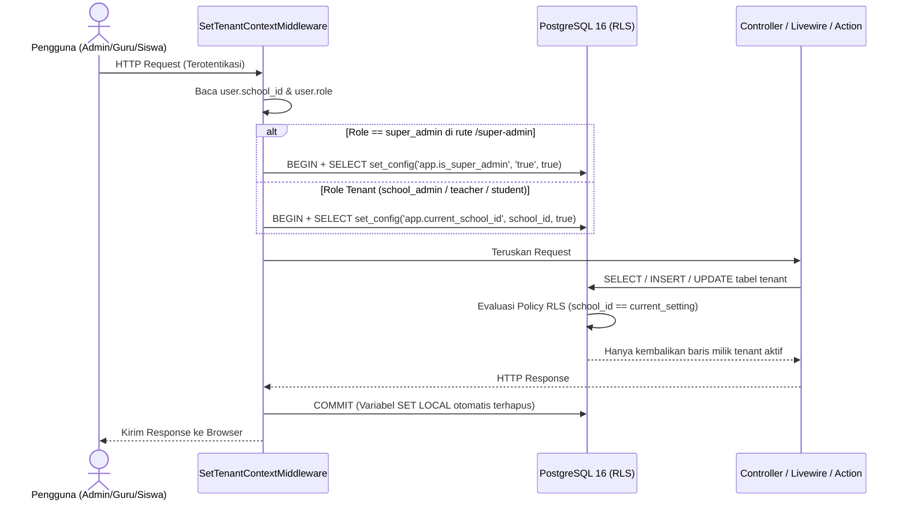

# Technical Specification Document (TSD) - Jurnalin

**Versi Dokumen**: 1.0  
**Stack Utama**: Laravel 12 (PHP 8.4), PostgreSQL 16 (RLS), Filament v3, Livewire v3, Alpine.js, Tailwind CSS

---

## 1. Arsitektur Sistem & Pilihan Teknologi

Jurnalin dibangun sebagai **Modular Monolith** dengan satu basis kode dan satu database PostgreSQL untuk seluruh sekolah (tenant). Pemilihan arsitektur ini memprioritaskan kecepatan rilis oleh satu pengembang penuh waktu, biaya operasional server yang rendah, dan isolasi keamanan data yang ditegakkan langsung oleh mesin database.

### 1.1 Komponen Teknologi

| Lapisan | Teknologi Pilihan | Justifikasi Teknis |
|---|---|---|
| **Runtime & Framework** | PHP 8.4 + Laravel 12 | Ekosistem matang untuk autentikasi, validasi, antrean (*queue*), penjadwalan (*scheduler*), dan pengujian otomatis |
| **Database Utama** | PostgreSQL 16 | Mendukung **Row-Level Security (RLS)** native, tipe `UUID`, `JSONB` terindeks untuk rubrik penilaian fleksibel per sekolah, serta konsistensi transaksi ACID |
| **Panel Admin & Guru** | Filament v3 | Menyediakan builder tabel, form, modal aksi, dan halaman impor/ekspor tanpa perlu membangun komponen UI admin dari nol |
| **Portal Mobile Siswa** | Livewire v3 + Alpine.js + Tailwind CSS | Halaman ultra-ringan tanpa bundel SPA berat, memiliki akses langsung ke Geolocation API & Camera API browser melalui komponen Alpine.js |
| **Pemetaan Lokasi** | Leaflet.js + OpenStreetMap Tiles | Gratis tanpa biaya kuota API Google Maps untuk memilih titik koordinat tempat PKL di panel admin |
| **Impor / Ekspor Excel** | `openspout/openspout` (via Filament Import) | Memproses berkas `.xlsx` secara streaming dengan pemakaian memori tetap rendah |
| **Generator PDF** | `barryvdh/laravel-dompdf` | Merender template Blade HTML+CSS menjadi dokumen PDF A4 siap cetak dengan kop surat dan logo sekolah |
| **Object Storage** | S3-compatible (Cloudflare R2 / MinIO) | Menyimpan foto absensi, foto jurnal, logo sekolah, dan foto bukti form penilaian DUDI terpisah dari disk aplikasi |

---

## 2. Arsitektur Multi-Tenant & Penegakan PostgreSQL RLS

### 2.1 Prinsip Dual-Layer Tenant Isolation
Mengandalkan filter `WHERE school_id = ?` di kode aplikasi saja berisiko bocor apabila suatu saat ada query `DB::table(...)` mentah atau developer lupa menerapkan scope. Karena itu, isolasi Jurnalin ditegakkan oleh dua lapis secara bersamaan:

1. **Lapisan Database (Wajib & Mutlak)**: PostgreSQL Row-Level Security (`ENABLE ROW LEVEL SECURITY` dan `FORCE ROW LEVEL SECURITY`) diaktifkan pada seluruh tabel operasional (`teachers`, `students`, `companies`, `pkl_periods`, `placements`, `attendances`, `journals`, `assessments`).
2. **Lapisan Aplikasi (Kenyamanan Developer)**: Trait `App\Models\Concerns\BelongsToSchool` pada Eloquent Model otomatis menyisipkan `school_id` pada saat `creating` dan menambahkan `GlobalScope` untuk menjaga kejelasan query.

### 2.2 Siklus Request & Transaction-Local Session Variable

Untuk mencegah kontaminasi state antar-request saat memakai *connection pooling* (seperti PgBouncer atau Laravel Octane), variabel sesi `app.current_school_id` wajib disetel dengan parameter `is_local = true` (`SET LOCAL`) di dalam cakupan transaksi database.



**Catatan Penting untuk Antrean (*Queue Jobs*)**:
Setiap *Queued Job* (misalnya proses impor Excel di latar belakang atau pembuatan PDF massal) tidak melewati middleware HTTP. Oleh karena itu, seluruh Job yang memproses data sekolah wajib menerima `$schoolId` di konstruktor dan membungkus eksekusinya dengan `TenantContext::runInSchoolScope($this->schoolId, fn () => ...)`.

---

## 3. Desain Komponen Teknis Utama

### 3.1 Validasi Absensi Geotagging & Kompresi Foto
1. **Lapisan Klien (Alpine.js di Mobile Browser)**:
   - Memanggil `navigator.geolocation.getCurrentPosition` dengan `enableHighAccuracy: true`, `timeout: 15000`, `maximumAge: 0` (mencegah koordinat usang dari cache).
   - Menampilkan estimasi jarak ke hotel secara real-time sebagai panduan visual bagi siswa.
   - Saat siswa mengambil foto menggunakan `<input type="file" accept="image/*" capture="user">`, skrip klien membaca gambar ke elemen `<canvas>`, melakukan downscale sehingga sisi terpanjang maksimal `1280px`, dan mengekspornya sebagai JPEG/WebP kualitas `0.75` sebelum diunggah via Livewire (`WithFileUploads`). Ukuran foto turun drastis menjadi sekitar `80 KB - 150 KB`.
2. **Lapisan Server (`RecordCheckInAction`)**:
   - Server **tidak pernah mempercayai** nilai jarak atau status radius yang dikirim klien.
   - Server mengambil koordinat lokasi penempatan dari database (`companies.latitude`, `companies.longitude`, serta radius efektif `COALESCE(companies.geofence_radius_m, schools.default_geofence_radius_m)`).
   - Server menghitung jarak menggunakan formula Haversine di `Coordinates::distanceMetersTo()`.
   - Jika jarak > radius efektif dan siswa tidak menyertakan `exception_reason` (tugas luar area hotel), server menolak permintaan dengan pesan validasi. Jika menyertakan alasan tugas luar, absensi disimpan dengan `is_within_radius = false` dan ditandai agar guru meninjau di dashboard.

### 3.2 Mesin Rubrik Penilaian Dinamis (`JSONB`)
Setiap periode PKL dapat memiliki komponen penilaian berbeda sesuai jurusan dan kurikulum sekolah. Struktur `pkl_periods.assessment_template` disimpan sebagai `JSONB`:

```json
{
  "scale": { "min": 0, "max": 100 },
  "weights": {
    "industry_percentage": 70,
    "school_percentage": 20,
    "attendance_percentage": 10
  },
  "industry_aspects": [
    { "code": "soft_skills", "label": "Internalisasi dan Penerapan Soft Skills (Disiplin, Komunikasi, Etika)", "weight": 40 },
    { "code": "hard_skills", "label": "Penerapan Hard Skills & SOP Divisi", "weight": 45 },
    { "code": "initiative", "label": "Kemandirian dan Inisiatif Kerja", "weight": 15 }
  ],
  "school_aspects": [
    { "code": "journal_quality", "label": "Kelengkapan dan Kualitas Jurnal Harian", "weight": 50 },
    { "code": "report_presentation", "label": "Laporan Akhir dan Presentasi PKL", "weight": 50 }
  ],
  "predicates": [
    { "min": 90, "label": "Amat Baik" },
    { "min": 80, "label": "Baik" },
    { "min": 70, "label": "Cukup" },
    { "min": 0, "label": "Kurang" }
  ]
}
```

### 3.3 Penyimpanan Dokumen & Privasi Media
Seluruh berkas tersimpan di bucket privat S3/R2 dengan struktur jalur berbasis tenant:
- Foto absensi: `schools/{school_id}/periods/{period_id}/attendances/{Y-m}/{uuid}.webp`
- Foto jurnal: `schools/{school_id}/periods/{period_id}/journals/{Y-m}/{uuid}.webp`
- Foto bukti nilai kertas hotel: `schools/{school_id}/periods/{period_id}/assessments/{placement_id}.webp`
- Logo kop sekolah: `schools/{school_id}/branding/logo.png`

Akses gambar oleh guru atau admin menggunakan *Temporary Signed URL* berumur 15 menit yang hanya dibuat setelah verifikasi policy akses tenant.

---

## 4. Penerapan Design Patterns (`/design-patterns`)

Mengacu pada prinsip `design-patterns`, pola arsitektur berikut digunakan secara selektif hanya pada bagian yang membutuhkan keamanan tipe data, kejelasan status, atau isolasi sumber daya:

### Pattern 1: Newtype / Value Object (Type Safety)
Mencegah tertukarnya nilai primitif seperti `(latitude, longitude)`, format NPSN, atau pecahan bobot penilaian.

```php
<?php

declare(strict_types=1);

namespace App\ValueObjects;

use InvalidArgumentException;

final readonly class Coordinates
{
    public function __construct(
        public float $latitude,
        public float $longitude,
    ) {
        if ($latitude < -90.0 || $latitude > 90.0) {
            throw new InvalidArgumentException("Latitude harus berada di antara -90 dan 90.");
        }
        if ($longitude < -180.0 || $longitude > 180.0) {
            throw new InvalidArgumentException("Longitude harus berada di antara -180 dan 180.");
        }
    }

    public function distanceMetersTo(self $target): int
    {
        $earthRadiusMeters = 6_371_000;
        $latFrom = deg2rad($this->latitude);
        $lonFrom = deg2rad($this->longitude);
        $latTo = deg2rad($target->latitude);
        $lonTo = deg2rad($target->longitude);

        $latDelta = $latTo - $latFrom;
        $lonDelta = $lonTo - $lonFrom;

        $angle = 2 * asin(sqrt(
            (sin($latDelta / 2) ** 2) +
            cos($latFrom) * cos($latTo) * (sin($lonDelta / 2) ** 2)
        ));

        return (int) round($angle * $earthRadiusMeters);
    }
}
```

### Pattern 2: State Machine via Backed Enum
Mencegah transisi status ilegal (misalnya siswa mengubah jurnal yang sudah disetujui kembali menjadi draft).

```php
<?php

declare(strict_types=1);

namespace App\Enums;

enum JournalStatus: string
{
    case Draft = 'draft';
    case Submitted = 'submitted';
    case RevisionNeeded = 'revision_needed';
    case Approved = 'approved';

    public function canTransitionTo(self $next): bool
    {
        return match ($this) {
            self::Draft => in_array($next, [self::Submitted], true),
            self::Submitted => in_array($next, [self::Approved, self::RevisionNeeded], true),
            self::RevisionNeeded => in_array($next, [self::Submitted], true),
            self::Approved => false,
        };
    }

    public function isEditableByStudent(): bool
    {
        return $this === self::Draft || $this === self::RevisionNeeded;
    }
}
```

### Pattern 3: Strategy Pattern (Perhitungan Rubrik & Ekspor PDF)
Memungkinkan variasi logika perhitungan nilai atau jenis laporan PDF tanpa rantai `if/elseif` panjang di controller:
- `App\Services\Assessment\WeightedRubricCalculator`: menghitung `final_score` berdasarkan struktur `AssessmentRubric` milik periode terkait (dan siap jika sekolah memilih skema bobot berbeda per jurusan di masa depan).
- `App\Contracts\ReportGenerator` dengan implementasi `StudentLogbookPdfGenerator` dan `PeriodRecapPdfGenerator`.

### Pattern 4: RAII / Scoped Tenant Context
Memastikan `app.current_school_id` di PostgreSQL selalu terikat pada transaksi yang jelas dan tidak pernah tersisa di koneksi database setelah blok selesai dijalankan.

```php
<?php

declare(strict_types=1);

namespace App\Support;

use Closure;
use Illuminate\Support\Facades\DB;

final class TenantContext
{
    /**
     * Menjalankan closure di dalam transaksi PostgreSQL dengan konteks RLS tenant terikat.
     */
    public static function runInSchoolScope(string $schoolId, Closure $callback): mixed
    {
        return DB::transaction(function () use ($schoolId, $callback) {
            DB::statement("SELECT set_config('app.is_super_admin', 'false', true)");
            DB::statement("SELECT set_config('app.current_school_id', ?, true)", [$schoolId]);

            return $callback();
        });
    }
}
```

---

## 5. Strategi Pengujian Otomatis (`TenantIsolationTest`)

Pengujian otomatis dijalankan menggunakan **Pest PHP** terhadap database PostgreSQL nyata (bukan SQLite in-memory, karena SQLite tidak memiliki Row-Level Security).

```php
// tests/Feature/TenantIsolationTest.php
it('blocks school A teacher from reading or modifying school B student journals via RLS and HTTP', function () {
    $schoolA = School::factory()->active()->create();
    $schoolB = School::factory()->active()->create();

    $teacherA = User::factory()->teacher()->for($schoolA)->create();
    $studentB = Student::factory()->for($schoolB)->create();
    $journalB = Journal::factory()->for($schoolB)->for($studentB)->create([
        'activity_title' => 'Rahasia Sekolah B',
    ]);

    // 1. Uji di tingkat koneksi PostgreSQL RLS
    TenantContext::runInSchoolScope($schoolA->id, function () use ($journalB) {
        expect(Journal::query()->whereKey($journalB->id)->count())->toBe(0);
        expect(DB::table('journals')->where('id', $journalB->id)->count())->toBe(0);
    });

    // 2. Uji di tingkat endpoint/panel aplikasi
    $this->actingAs($teacherA)
        ->get("/app/journals/{$journalB->id}")
        ->assertNotFound();
});
```

---

## 6. Ponytail Architecture Audit (`/ponytail-audit`)

Untuk menjaga kode tetap ramping bagi satu developer dan menghindari abstraksi prematur, batasan arsitektur berikut ditetapkan sejak awal:

- `yagni: Repository pattern (StudentRepositoryInterface, EloquentStudentRepository). Langsung gunakan Eloquent Model + Query Scope.`
- `yagni: Package stancl/tenancy penuh (multi-DB/subdomain provisioning). Langsung gunakan satu Trait BelongsToSchool + 1 Middleware SetTenantContextMiddleware + PostgreSQL RLS.`
- `yagni: Event Sourcing / CQRS terpisah untuk status jurnal dan absensi. Langsung gunakan Backed Enum State Machine dan kolom timestamp validasi.`
- `native: API Google Maps Geocoding & Places untuk pin lokasi tempat PKL. Langsung gunakan Leaflet.js + OpenStreetMap + input koordinat manual.`
- `native: Queue worker kompleks (Horizon/Redis cluster) di tahap pilot awal. Langsung gunakan PostgreSQL database queue driver bawaan Laravel.`
- `stdlib: Library external hitung jarak geografis. Langsung tulis metode 15 baris Haversine di App\ValueObjects\Coordinates.`
- `delete: Tabel mentors, partnerships, dan fitur magic link login hotel di MVP. Simpan nama dan nomor kontak supervisor sebagai kolom teks di placements hingga fase V2.`

Status kode eksisting: `Lean already. Ship.` (repositori masih pada fase dokumentasi sebelum inisialisasi kode).
